# LED Sign

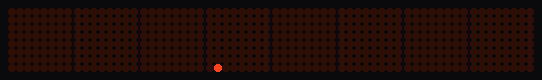

A 64×8 LED message sign made from eight MAX7219 8×8 LED modules, run by an **Arduino UNO**
or a **Raspberry Pi Zero W**. It plays animated holiday shows with pixel-art characters and
jokes. On the Pi it also shows **live NFL scores** and has a **phone page** for typing your
own messages.

Everything here is open source (MIT license): the code, the 3D-printable case and holder,
and the tools that made the pictures on this page.

## What it looks like

The current show is **Thanksgiving**, about 85 seconds a pass:

| | |
|---|---|
| 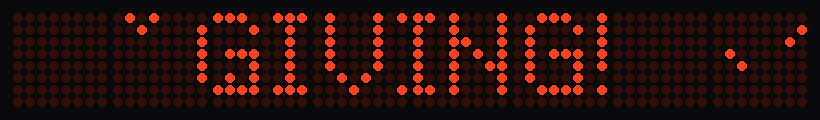 | 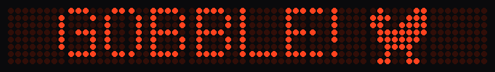 |
| Leaves fall, then HAPPY / THANKS / GIVING! drop in | A turkey struts in and gobbles |
| 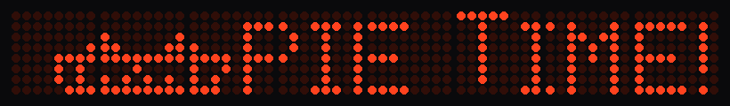 | 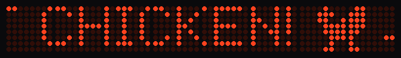 |
| A pumpkin pie gets eaten: NOM! NOM! BURP! | Jokes scroll by with a parade behind them |
| 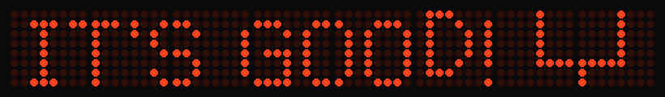 | 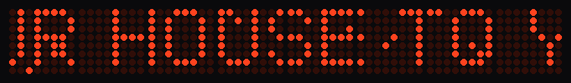 |
| A field goal… IT'S GOOD! | HAPPY THANKSGIVING FROM OUR HOUSE TO YOURS! |

Earlier shows are kept in releases, ready to bring back (see [Make it yours](#make-it-yours)):

| | |
|---|---|
| 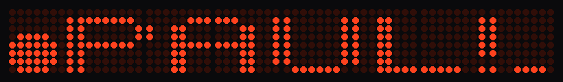 | 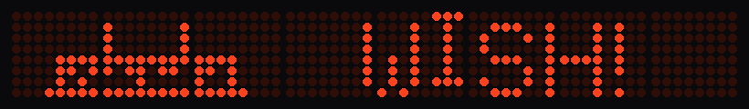 |
| **Birthday** (v1.1.0): names do the wave | Candles, a wish, then the cake gets eaten |
| 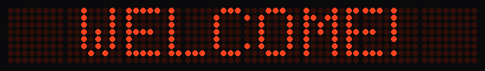 | 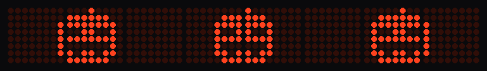 |
| **Halloween** (v1.0.0): WELCOME! | Jack-o'-lanterns, bats, ghosts and a BOO! finale |

On the Pi, **every other screen is today's NFL scores**, three games at a time with a
bouncing football:

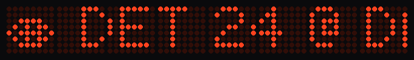

And the **phone page** (open `http://ledsign.local` on the same Wi-Fi) lets anyone in the
house type a message, set the brightness, skip or pause, and pick a favorite team:

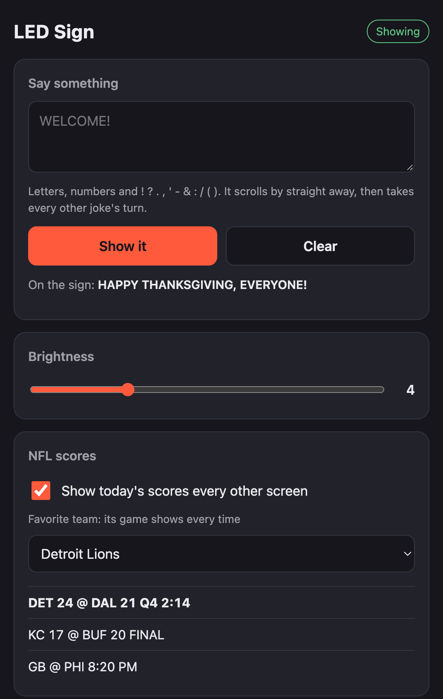

## What you need

- **Eight MAX7219 8×8 LED modules**, 32 mm square, chained in a row (single modules or two
  4-in-1 boards both work).
- **A controller**, either:
  - an **Arduino UNO**: the simplest; its 5 V pins match the display. No Wi-Fi.
  - a **Raspberry Pi Zero W**: adds the phone page and live scores. Its pins are 3.3 V,
    which drove our display fine; see [Wiring](#wiring) if yours doesn't.
- **Jumper wires**: five, female to female for the Pi, male to female for the UNO.
- **5 V USB power**: a phone power bank or charger. At the default brightness the whole sign
  draws about 150–300 mA. (A PiSugar battery board on the Pi gives 2–3 hours unplugged.)
- **Optional**: a 3D printer for the [case or bat holder](#3d-printed-case-and-holder), and an
  SN74AHCT125 level-shifter chip if your display ignores 3.3 V signals.

## Wiring

The modules chain together: each module's **OUT** header feeds the next module's **IN**. Your
controller connects to the **IN** header of the first module, labeled VCC, GND, DIN, CS and
CLK.

### Arduino UNO

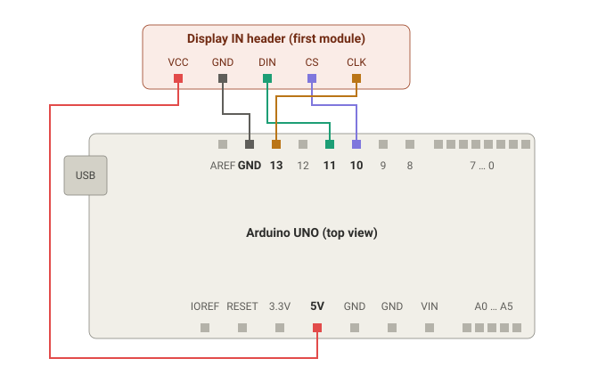

| Display IN | UNO pin |
|---|---|
| VCC | 5V |
| GND | GND |
| DIN | 11 |
| CS  | 10 |
| CLK | 13 |

### Raspberry Pi Zero W

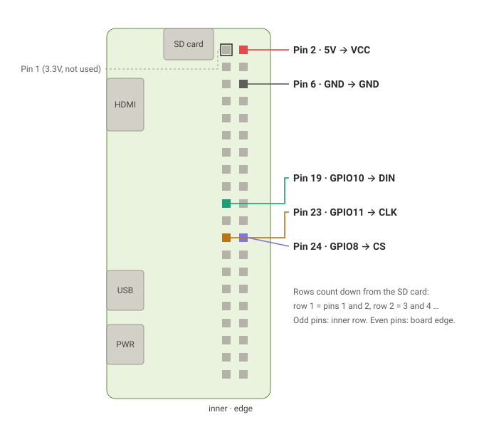

| Display IN | Pi Zero pin |
|---|---|
| VCC | 2 (5V) |
| GND | 6 (GND) |
| DIN | 19 (GPIO10, SPI MOSI) |
| CLK | 23 (GPIO11, SPI SCLK) |
| CS  | 24 (GPIO8, SPI CE0) |

Pin 1 is the header corner nearest the SD card; odd pins are on the inside row. **VCC goes
on pin 2**: 5 V on any other pin can damage the Pi. Wire it with the Pi switched off.

**If the display stays dark or shows garbage on the Pi**, its 3.3 V signals may be too weak
for your modules. Put an SN74AHCT125 (DIP-14) in between: pin 14 to 5V, pin 7 to GND, pins
1, 4, 10, 12 and 13 to GND; GPIO10 into pin 2 and pin 3 to DIN; GPIO11 into pin 5 and pin 6
to CLK; GPIO8 into pin 9 and pin 8 to CS.

An ESP32 won't drive these modules without that chip either (its pins are 3.3 V, and ours
stayed dark). For Wi-Fi without a Pi, an **Arduino UNO R4 WiFi** works like the UNO: same
5 V pins and wiring, plus Wi-Fi on board.

## Option A: Arduino UNO

The UNO version runs the show on its own: no Wi-Fi, no scores, no phone page.

1. Install [PlatformIO](https://platformio.org) (the VS Code extension, or
   `pip install platformio`) and plug the UNO into your computer.
2. **Check the wiring** (see [First run](#first-run-find-your-displays-orientation)).
3. Put your display's layout number in `src/config.h` as `ORIENTATION`, then upload the
   show:

   ```bash
   pio run -t upload
   ```

4. Unplug it from the computer and plug it into a USB power bank or charger. It starts by
   itself, and a 10,000 mAh bank lasts all night. (A 9 V battery on the barrel jack works
   too, but only for about two hours.) Brightness is `BRIGHTNESS` in `src/config.h` (0–15,
   default 2).

## Option B: Raspberry Pi Zero W

The Pi version adds the phone page, live NFL scores, and starts by itself about 40 seconds
after power-on.

1. **SD card.** In [Raspberry Pi Imager](https://www.raspberrypi.com/software/) choose
   Raspberry Pi Zero, then Raspberry Pi OS Lite (32-bit). In the customisation steps set the
   hostname `ledsign`, a user and password, your Wi-Fi and its country, your time zone (game
   times on the sign use it), and turn on SSH (public-key authentication with your
   computer's key is easiest).

   The Pi Zero W only joins **2.4 GHz** Wi-Fi with **WPA2**. On a newer Wi-Fi 7 or WPA3-only
   router it may not get on at all: allow WPA2 on the 2.4 GHz band, use an "IoT" network,
   or move it closer to the router.

2. **Wire** the display as above, then power the Pi up.
3. **Install** from your computer (replace `you` with the user you chose):

   ```bash
   pi/deploy.sh --setup you@ledsign.local
   ```

   That copies the program over, turns on the Pi's SPI pins, builds it on the Pi (about
   45 seconds) and installs it to start at every boot. It asks for your Pi password at the
   steps that need `sudo`. Later updates are just `pi/deploy.sh you@ledsign.local`.

4. **Check the wiring and orientation** (see [First run](#first-run-find-your-displays-orientation)):
   `ssh you@ledsign.local`, then `sudo systemctl stop led-sign`, run `ledsign --test` or
   `ledsign --finder`, Ctrl-C, and `sudo systemctl start led-sign`. Put the layout number in
   `src/config.h` and run `pi/deploy.sh` again.
5. **Phone page.** Open `http://ledsign.local` on a phone on the same Wi-Fi. A new message
   scrolls by straight away, then takes every other joke's turn until you clear it. There's
   no password, so anyone on your Wi-Fi can use it.

**NFL scores.** `pi/scores.py` checks ESPN's public scoreboard (unofficial, no key needed)
every 30 seconds while games are on, and every other screen of the show is a scores ticker:
`BUF 17 @ KC 21 Q3 4:32`, `NYG 10 @ DAL 24 FINAL`, `MIA @ NE 1:00 PM`. The phone page turns
scores on or off and sets a favorite team whose game shows every time. With no games today
there are no scores screens.

**Power.** Any USB power bank or charger in the Pi's power port. With a PiSugar battery
board it runs 2–3 hours on battery; keep it plugged in to run all day. If the battery runs
completely flat, the Pi may not rejoin Wi-Fi until it's restarted on USB power.

## First run: find your display's orientation

Module makers wire their LEDs differently, and the chain can enter from either end, so the
sign needs to know its layout: a number from 0 to 15 in `src/config.h` (`ORIENTATION`).
Garbage on the display almost always means this number, or the wire order, is wrong.

**1. Wiring test** (UNO: `pio run -e uno-wiring -t upload`; Pi: `ledsign --test`). On the
UNO it tries the three signal wires in all six orders, 5 seconds each, each with its own
shape: square outline, X, plus, centre dot, two squares, four corners. A clean square on all
8 modules means the wiring matches the table. Any other clean shape means wires are swapped:
the serial monitor (`pio device monitor`) prints which pin each wire is really on for each
shape (`X: DIN 13, CLK 11, CS 10`), so move them to match the table. On the Pi, `--test`
shows the square only; if it isn't clean, check the wires against the Pi table.

**2. Orientation finder** (UNO: `pio run -e uno-finder -t upload`; Pi: `ledsign --finder`).
It tries the 8 ways a module's LEDs can be wired, 4 seconds each: every module shows an F
with a column of dots beside it. When the F's look like normal F's, count the dots:
`ORIENTATION` is `(dots − 1) × 2`, plus 1 if the cable enters at the right-hand end of the
sign (seen from the front). The Pi version also prints the number for each step. If the
show's words then come out in the wrong module order, add or remove that 1.

The sign these instructions were written on is `ORIENTATION 5`: modules mirrored left to
right, cable at the right-hand end.

## Make it yours

- **Words**: everything the sign says is in `src/messages.h`: greetings, lists and the
  jokes. The font (`src/font.h`) has capital letters, digits and the usual punctuation.
- **Pictures**: the turkey, pie and friends are 8×8 pixel art in `src/sprites.h`, one byte
  per row, so you can draw your own with `0b00111100`-style rows.
- **Animations**: the scenes are in `src/show.cpp`; `runShow()` at the bottom sets their
  order.
- **Earlier shows**: Halloween is release `v1.0.0` and the birthday show is `v1.1.0`. To
  bring one back, `git checkout v1.1.0 -- src/messages.h src/show.cpp src/sprites.h` and
  rebuild (keep the newer `src/show.h` and `pi/` files).
- **Try it on your computer first**: `tools/preview/build.sh` runs the show and writes
  `tools/preview/build/preview.html`, which plays every frame on a picture of the sign.
  With `PREVIEW_SCORES=file` it adds scores screens from a file of game lines.
  `tools/preview/screenshots.py` turns moments of a preview into the pictures on this page
  (needs `pip install pillow`).
- **The Pi program without a Pi**: `make -C pi term` builds `pi/ledsign-term`, which draws the
  sign in a terminal, and `python3 pi/web/server.py --port 8033 --settings /tmp/settings`
  serves the phone page (run `ledsign-term` with `LEDSIGN_SETTINGS=/tmp/settings`).

## 3D-printed case and holder

Everything prints face down exactly as exported, with no supports. Our settings for PLA
on a 225 mm bed: 0.2 mm layers, 3 walls, 15 % infill, adhesion Skirt or None. Both designs
are Python scripts with every size at the top (`pip install manifold3d numpy`), and
`holder/viewer.html` shows them in 3D (`python3 -m http.server --directory holder 8032`,
then open http://localhost:8032/viewer.html).

### Plain case

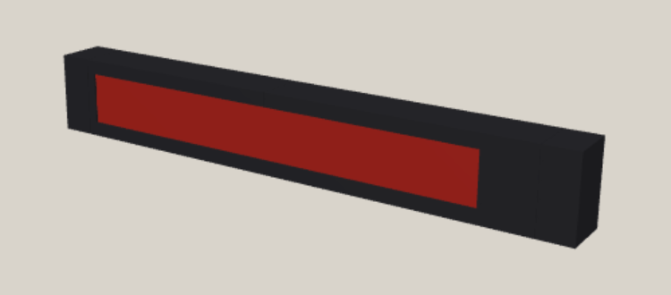

A frame around the display only, open at the back, with a Command strip pad at each end. A
bay at the right-hand end holds the sideways cable plug, and a slot underneath lets the wires
out. Print `holder/stl/case-left.stl`, `case-right.stl` and `pins.stl` together: about
1–1.5 hours and 64 g.

1. Push two pins into one half (a drop of super glue holds them) and press the halves together.
2. Lay the case face down and lower the LED strip in from the back, LEDs down, with the plug
   in the bay. Feed the wires out through the slot and tape across the module backs.
3. One Command strip on each end pad, and press it to the wall or door for 30 seconds.

`python3 holder/case.py` rebuilds it.

### Bat door holder


A Halloween bat whose body is the sign: the right wing hides an UNO, the left wing a power
bank, and it hangs with Command strips.

| File | Print time | Notes |
|---|---|---|
| `fit-test.stl` | ~10 min | Print first: slide it onto an end module to check the fit |
| `pins.stl` | ~5 min | Four alignment pins |
| `right-half-uno.stl` | ~1.5–2 h, ~63 g | 216 × 176 mm |
| `left-half-power-bank.stl` | ~1.5–2 h, ~62 g | 216 × 176 mm |

Too tight or too loose on the fit test: change `FIT` in `holder/holder.py` (0.1 mm steps)
and run it again. Hang it with small Command strips: two on each wing post and one each on
the bat's head and feet.

## Project layout

| Path | What it is |
|---|---|
| `src/config.h` | Pins, orientation, brightness |
| `src/messages.h` | The words |
| `src/show.cpp` | The scenes and effects |
| `src/sprites.h` | 8×8 pixel art |
| `src/font.h` | 5×7 letters |
| `src/matrix.cpp`, `src/matrix_map.h` | Driving the MAX7219 chips (map shared with the Pi) |
| `src/main.cpp` | UNO setup, the wiring test and orientation finder |
| `pi/` | The Pi program, SPI driver, phone page, scores, services and deploy script |
| `holder/` | 3D-printable case and bat holder, their scripts and the 3D viewer |
| `tools/preview/` | Run the show on a computer; make screenshots |
| `CHANGELOG.md` | What changed in each release |

## License

MIT: see [LICENSE](LICENSE). Use it, change it, share it.
